# Technique 6: Knowledge distillation

*Transferring capabilities and knowledge from a large model to a smaller one.*

## What is it and how does it work?

Knowledge distillation trains a small **student** model to imitate a large **teacher**
model. The idea, formalized by Hinton, Vinyals and Dean (2015), is that a teacher's full
output distribution carries much more information than a single correct label. If a
teacher classifying an image says "dog: 0.90, wolf: 0.09, car: 0.0001", the student learns
not only that it is a dog but also that dogs resemble wolves far more than cars. This is what
Hinton called **"dark knowledge"**.

Classic (logit-based) distillation:
1. Run the teacher on training inputs and take its output logits.
2. Soften both teacher and student distributions with a **temperature** *T* > 1 in the
   softmax, which spreads probability across more classes and exposes the dark knowledge.
3. Train the student on a weighted combination of two losses:
   - the KL divergence between the softened teacher and student distributions
     (scaled by *T²*), and
   - the normal cross-entropy loss with the true labels.

The same teacher logits at two temperatures. Raising the temperature makes the small probabilities visible, so the student learns how the classes relate to each other.

Variants used with LLMs:
- **Sequence-level / black-box distillation**: the teacher generates complete answers
  (often with reasoning) for many prompts, and the student is simply fine-tuned on that
  synthetic dataset. Only the teacher's text outputs are needed, not its weights. Stanford
  Alpaca (2023) fine-tuned LLaMA-7B on 52K instruction examples generated by an OpenAI
  model; DeepSeek-R1 (2025) distilled its reasoning ability into smaller Qwen and Llama
  models (1.5B to 70B) by fine-tuning them on about 800K samples generated by R1.
- **White-box distillation**: when the teacher's logits or hidden states are available,
  the student also matches token-level distributions or internal representations (e.g.,
  DistilBERT matched BERT's outputs and hidden states).
- **On-policy / generalized distillation**: the student generates outputs and the teacher
  scores or corrects them, reducing the mismatch between training and use.

## How is the knowledge incorporated?

The teacher's knowledge is **transferred into the student's weights through training**.
Nothing about the teacher is needed at inference time: the student answers on its own.
Distillation compresses *capabilities* (classification, reasoning style, instruction
following) more than it adds new facts. The student cannot know more than the teacher
taught it, and typically retains somewhat less.

## Are the model's parameters modified?

**Yes, the student's parameters** are trained (from scratch or from a pre-trained small
model). The teacher's parameters are not modified.

## Advantages

- Much smaller, faster and cheaper models: DistilBERT (Sanh et al., 2019) is 40% smaller
  and 60% faster than BERT while retaining 97% of its language-understanding performance.
- Enables deployment on edge devices, phones, laptops and on-premise hardware.
- Lower inference cost and latency at scale; better privacy (runs locally).
- A specialized small student can rival a general large model on its narrow task.

## Disadvantages

- Requires a strong teacher and lots of compute to generate data and train the student.
- The student inherits the teacher's errors, biases and blind spots, and loses some
  quality, especially on tasks outside the distillation data.
- Knowledge is frozen again; updating it requires distilling again.
- **Legal/licensing**: many commercial model providers' terms forbid using their outputs
  to train competing models.
- White-box methods need access to the teacher's logits or weights.

## Tools to implement it

- Hugging Face Transformers (custom Trainer with a distillation loss); **TRL**
  GKDTrainer (generalized knowledge distillation) and SFTTrainer for black-box
  distillation.
- PyTorch for custom KD losses; torchtune knowledge-distillation recipes.
- NVIDIA NeMo (pruning + distillation, as used for the Minitron model family).
- Synthetic data generation: any large LLM API or vLLM, plus tools like distilabel.
- Managed: some providers offer model distillation workflows built on stored outputs
  from their large models.

## Practical example

A company runs a customer-intent classifier using a large LLM API, which works well but
costs too much per request and adds latency. They send 50,000 historical customer
messages to the large model and save its predicted intents and probability scores. Then
they fine-tune a small model (e.g., a 66M-parameter DistilBERT) on these soft labels
using a KD loss. The student reaches nearly the teacher's accuracy, runs on a CPU in a few
milliseconds per message, and costs almost nothing to operate.

## Security lens

Distillation is the legitimate twin of **model extraction (model stealing)**. An attacker
queries a victim's API many times and trains a copy on the responses. Tramèr et al. (2016)
demonstrated extraction of ML models from prediction APIs, and Carlini et al. (2024)
recovered the entire projection matrix (the final layer) of OpenAI's Ada and Babbage
language models for under US$20 of queries. Defences include rate limiting, query monitoring, returning fewer
details (no full probability vectors) and output watermarking. Students also inherit any
backdoors or unsafe behaviours present in the teacher's outputs, so teacher outputs should
be filtered before training.

## References

- Hinton, Vinyals & Dean (2015). *Distilling the Knowledge in a Neural Network.* arXiv:1503.02531.
- Sanh et al. (2019). *DistilBERT, a distilled version of BERT.* arXiv:1910.01108.
- Taori et al. (2023). *Stanford Alpaca: An Instruction-following LLaMA model.* GitHub.
- DeepSeek-AI (2025). *DeepSeek-R1: Incentivizing Reasoning Capability in LLMs via Reinforcement Learning.* arXiv:2501.12948.
- Tramèr et al. (2016). *Stealing Machine Learning Models via Prediction APIs.* USENIX Security.
- Carlini et al. (2024). *Stealing Part of a Production Language Model.* arXiv:2403.06634.
